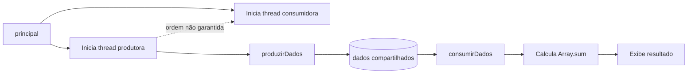

# Relatório sobre implementação de comunicação entre tarefas em F#

## Introdução

Este relato faz parte do processo avaliativo da disciplina de sistemas operacionas no curso superior em análise e desenvolvimento de sistemas, ofertado na Diretoria acadêmica de gestão e tecnologia da informação no campus natal-central do instituto federal de educação, ciência e tecnologia do rio grande do norte.

Tem como objetivo principal relatar as implementações de comunicação entre tarefas na linguagem F#.

O grupo de trabalho foi formado por Arthur Santos, Ítalo Bruno e João Ricardo.

## Resumo

Foram implementadas em F# três formas de comunicação: compartilhamento de dados entre threads, pipe entre processos no mesmo computador e socket TCP entre processos. Também foram mantidos os exemplos de execução sequencial e importação de módulo. O `Dockerfile` usa o SDK 8.0 do .NET para padronizar a execução.

## Diagrama do produtor-consumidor



## Comunicação entre tarefas em F#

### Informações gerais

Comunicação entre tarefas permite que partes de um programa troquem dados e coordenem sua execução. Essa comunicação é necessária quando se deseja dividir o trabalho entre threads ou processos, melhorar o aproveitamento do processador e organizar programas concorrentes. Também é preciso controlar a ordem de acesso aos dados compartilhados para evitar condições de corrida.

O Docker foi escolhido porque fornece um ambiente reproduzível para a execução dos códigos. Assim, a versão do SDK, as bibliotecas e o sistema usado para executar o F# ficam padronizados, independentemente da configuração do computador de cada integrante.

O arquivo `Dockerfile` usa a imagem oficial `mcr.microsoft.com/dotnet/sdk:8.0`, define `/app` como diretório de trabalho, copia os scripts de `src/F#` e configura `dotnet fsi` como ponto de entrada. O comando padrão executa `sequencial.fsx`, mas qualquer um dos scripts pode ser informado ao iniciar o contêiner.

Para construir a imagem e executar os exemplos, use os comandos a partir da raiz do repositório:

```powershell
docker build -t ativ3-fsharp .
docker run --rm ativ3-fsharp etapa1/sequencial.fsx --run
docker run --rm ativ3-fsharp etapa1/produtor_consumidor.fsx --run
docker run --rm ativ3-fsharp etapa1/exemplo_main.fsx

# Etapa 2: pipe entre dois processos
docker run --rm ativ3-fsharp etapa2/produtor_pipe.fsx | docker run --rm -i ativ3-fsharp etapa2/consumidor_pipe.fsx

# Etapa 3: socket TCP entre dois contêineres
docker network create ativ3-net
docker run -d --rm --name ativ3-servidor --network ativ3-net ativ3-fsharp etapa3/socket_servidor.fsx 5000
docker run --rm --network ativ3-net ativ3-fsharp etapa3/socket_cliente.fsx ativ3-servidor 5000
docker stop ativ3-servidor
docker network rm ativ3-net
```

### Comunicação entre tarefas com linhas de execução no mesmo processo

O arquivo `etapa1/produtor_consumidor.fsx` é a tradução de `produtor-consumidor.py`. A variável `dados` é compartilhada pelas duas threads. A thread produtora gera 100 números aleatórios entre 0 e 110 e grava a lista; a thread consumidora lê a lista e calcula sua soma. `Thread.Start()` inicia as duas linhas de execução.

Esta tradução mantém o comportamento do Python original, inclusive a ausência de `Join`, mutex ou evento de sincronização. Portanto, a thread consumidora pode começar antes de a produtora preencher `dados`, o que caracteriza uma condição de corrida. Uma versão de produção deveria usar uma sincronização, como `AutoResetEvent`, ou uma fila concorrente.

Código completo:

```fsharp
open System
open System.Threading

let gerador = Random()
let mutable dados: int array = [||]

let produzirDados () =
	printfn "# produzir - iniciado"
	dados <- Array.init 100 (fun _ -> gerador.Next(0, 111))
	printfn "# produzir %A" dados
	printfn "# produzir - terminado"
	dados

let consumirDados () =
	printfn "### consumir - iniciado"
	printfn "### dados -> %A" dados
	let resultado = Array.sum dados
	printfn "### resultado -> %d" resultado
	printfn "### consumir - terminado"

let principal () =
	printfn "iniciou"
	let threadProdutor = Thread(ThreadStart(fun () -> produzirDados () |> ignore))
	let threadConsumidor = Thread(ThreadStart(consumirDados))
	threadProdutor.Start()
	threadConsumidor.Start()
	printfn "finalizou"

if fsi.CommandLineArgs |> Array.contains "--run" then
	principal ()
```

Os comandos de construção e execução estão na seção de informações gerais. No ambiente utilizado, o executável `docker` estava instalado, mas o Docker Desktop não estava com o daemon Linux ativo. Por isso, a construção retornou `failed to connect to the docker API`. A saída de referência do Python foi:

```text
iniciou
# produzir - iniciado
### consumir - iniciado
### dados -> [lista de 100 números]
### resultado -> 5577
### consumir - terminado
finalizou
```

Os números e a soma mudam a cada execução. A ordem das mensagens das threads também pode mudar.

O problema encontrado foi a indisponibilidade do daemon do Docker. A solução é iniciar o Docker Desktop antes de executar os comandos. Também foi identificado o problema de sincronização herdado do código Python; ele deve ser corrigido com um mecanismo de coordenação entre produtor e consumidor quando for necessário garantir uma execução determinística.

### Comunicação entre tarefas em processos diferentes no mesmo computador

Esta etapa foi adicionada no repositório principal com os arquivos `src/python/produtor.py` e `src/python/consumidor.py`. Eles usam o pipe do terminal: o produtor escreve na saída padrão e o consumidor recebe essa saída pela entrada padrão. A execução é feita com o operador `|`, que conecta a saída de um processo à entrada do processo seguinte.

Na versão F#, `etapa2/produtor_pipe.fsx` gera 100 números aleatórios e escreve somente os números na saída padrão. `etapa2/consumidor_pipe.fsx` lê todo o conteúdo da entrada padrão, separa os valores por espaços ou quebras de linha, converte-os para inteiros e calcula a soma. Como os processos não compartilham a variável `dados`, a comunicação ocorre exclusivamente pelo pipe.

Código do produtor:

```fsharp
open System

let gerador = Random()
let dados = Array.init 100 (fun _ -> gerador.Next(0, 111))
printfn "%s" (String.Join(" ", dados))
```

Código do consumidor:

```fsharp
open System

let entrada = Console.In.ReadToEnd().Trim()

if String.IsNullOrWhiteSpace entrada then
	failwith "Nenhum dado foi recebido pelo pipe."

let dados =
	entrada.Split([| ' '; '\r'; '\n'; '\t' |], StringSplitOptions.RemoveEmptyEntries)
	|> Array.map Int32.Parse

printfn "entrada: %d valores recebidos" dados.Length
printfn "resultado -> %d" (Array.sum dados)
```

Execução:

```powershell
docker run --rm ativ3-fsharp etapa2/produtor_pipe.fsx | docker run --rm -i ativ3-fsharp etapa2/consumidor_pipe.fsx
```

Uma saída possível é:

```text
entrada: 100 valores recebidos
resultado -> 5384
```

O formato do protocolo é simples: uma única sequência de números inteiros separados por espaço. O pipe é encerrado quando o produtor termina sua saída, fazendo o consumidor terminar a leitura. Essa solução funciona no mesmo computador, mas não permite comunicação direta entre máquinas diferentes.

### Comunicação entre tarefas em processos diferentes em computadores diferentes

Para esta etapa foi implementada uma comunicação cliente-servidor usando sockets TCP. O arquivo `etapa3/socket_servidor.fsx` cria um `TcpListener`, aguarda uma conexão e recebe os números enviados pelo cliente. Depois, calcula a soma e envia uma resposta pela mesma conexão. O arquivo `etapa3/socket_cliente.fsx` gera os números, conecta-se ao endereço do servidor, envia os dados e lê o resultado.

O servidor recebe a porta como argumento e escuta em `IPAddress.Any`, permitindo conexões destinadas às interfaces disponíveis no contêiner. O cliente recebe o endereço e a porta como argumentos. O protocolo é uma linha com números inteiros separados por espaço; a resposta é uma linha contendo a soma.

Código essencial do servidor:

```fsharp
let servidor = TcpListener(IPAddress.Any, porta)
servidor.Start()
use cliente = servidor.AcceptTcpClient()
use fluxo = cliente.GetStream()
use leitor = new StreamReader(fluxo)
use escritor = new StreamWriter(fluxo, AutoFlush = true)
let entrada = leitor.ReadToEnd().Trim()
let dados = entrada.Split([| ' '; '\r'; '\n'; '\t' |], StringSplitOptions.RemoveEmptyEntries) |> Array.map Int32.Parse
escritor.WriteLine(sprintf "resultado -> %d" (Array.sum dados))
```

Código essencial do cliente:

```fsharp
use cliente = new TcpClient()
cliente.Connect(endereco, porta)
use fluxo = cliente.GetStream()
use escritor = new StreamWriter(fluxo, AutoFlush = true)
use leitor = new StreamReader(fluxo)
escritor.WriteLine(String.Join(" ", dados))
cliente.Client.Shutdown(SocketShutdown.Send)
printfn "servidor: %s" (leitor.ReadLine())
```

Para testar no Docker, os contêineres são colocados na mesma rede virtual:

```powershell
docker network create ativ3-net
docker run -d --rm --name ativ3-servidor --network ativ3-net ativ3-fsharp etapa3/socket_servidor.fsx 5000
docker run --rm --network ativ3-net ativ3-fsharp etapa3/socket_cliente.fsx ativ3-servidor 5000
docker stop ativ3-servidor
docker network rm ativ3-net
```

Uma saída possível do cliente é:

```text
servidor: resultado -> 5210
```

Em computadores físicos diferentes, o nome do contêiner seria substituído pelo endereço IP ou nome DNS do computador servidor. Também seria necessário liberar a porta 5000 no firewall. O cliente e o servidor não compartilham memória; toda a comunicação acontece pela rede usando o socket TCP.

## Considerações finais

Foi possível implementar em F# as três etapas: threads no mesmo processo, pipe entre processos no mesmo computador e socket TCP entre processos. Também foi criado o `Dockerfile`, que permite construir uma imagem com o SDK 8.0 do .NET e executar os scripts sem instalar o F# diretamente na máquina. A etapa do pipe foi baseada na atualização encontrada no repositório principal; a etapa de socket foi implementada como extensão do trabalho, pois ainda não havia um exemplo correspondente no upstream.

O principal aprendizado foi a diferença entre executar funções sequencialmente, compartilhar memória entre threads e comunicar processos. Também ficou evidente que iniciar duas threads não garante a ordem de execução: a sincronização precisa ser especificada pelo programa.

Para os próximos alunos, recomenda-se iniciar o Docker Desktop antes dos testes, usar `Join` e um mecanismo de sincronização no produtor-consumidor e registrar as versões do SDK e os comandos usados. Também é importante separar claramente os exemplos de threads, IPC local e comunicação por rede, pois eles têm problemas e soluções diferentes.

## Vídeo:

https://drive.google.com/file/d/1Smxi6IbPCZucGttWz_6p96QgYjUXiHsQ/view?usp=sharing
